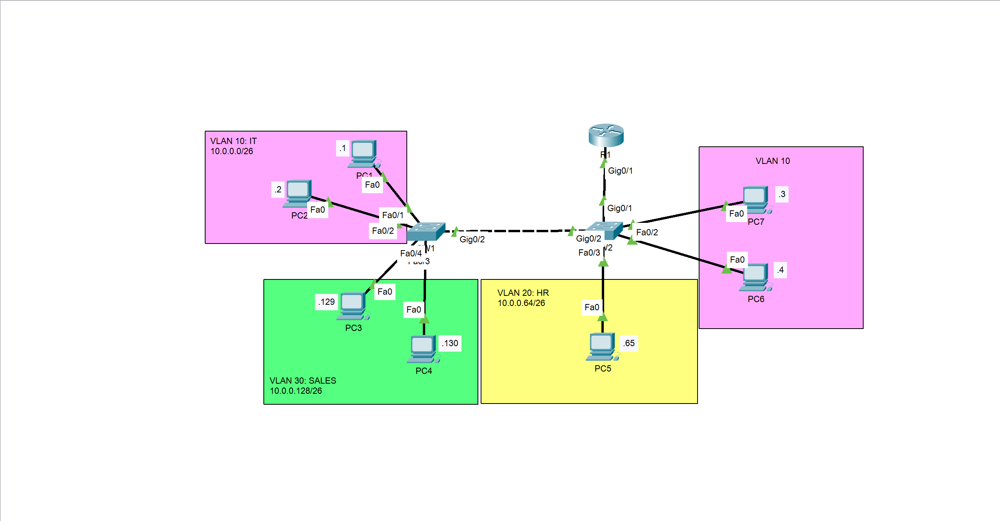

# Inter-VLAN Routing — Router-on-a-Stick

A Cisco Packet Tracer lab demonstrating inter-VLAN routing using a Router-on-a-Stick (ROAS) architecture, IEEE 802.1Q trunking, and router subinterfaces.

## Overview

This project implements inter-VLAN routing in a small switched network. Instead of using a separate physical router interface for each VLAN, a single router interface is divided into logical subinterfaces, each acting as the default gateway for a VLAN.

The lab also demonstrates VLAN segmentation across two switches, trunk configuration, native VLAN handling, and end-to-end connectivity verification.

## Network Topology



The simulated network consists of:

- 1 Cisco router (R1)
- 2 Cisco switches (SW1 and SW2)
- 7 PCs
- 3 user VLANs
- 1 native VLAN
- 802.1Q trunk links between the network devices

## VLANs and IP Addressing

The network uses VLSM with `/26` subnets.

| VLAN | Name | Network | Default Gateway |
|---:|---|---|---|
| 10 | IT | `10.0.0.0/26` | `10.0.0.62` |
| 20 | HR | `10.0.0.64/26` | `10.0.0.126` |
| 30 | SALES | `10.0.0.128/26` | `10.0.0.190` |
| 1001 | Native | `10.0.0.192/26` | `10.0.0.254` |

Subnet mask: `255.255.255.192`

The last usable IP address of each subnet is assigned to its corresponding router subinterface.

## Router-on-a-Stick Architecture

R1 uses its `GigabitEthernet0/1` physical interface to carry traffic for multiple VLANs through logical subinterfaces.

| Router subinterface | VLAN | IP address |
|---|---:|---|
| `G0/1.10` | 10 | `10.0.0.62/26` |
| `G0/1.20` | 20 | `10.0.0.126/26` |
| `G0/1.30` | 30 | `10.0.0.190/26` |
| `G0/1.1001` | 1001 (native) | `10.0.0.254/26` |

Each subinterface uses IEEE 802.1Q encapsulation to associate incoming and outgoing traffic with the appropriate VLAN. VLAN 1001 is configured as the native VLAN on the trunk links.

## Key Configurations

- VLAN creation and naming
- Access-port assignment for end devices
- Static trunk configuration using `switchport mode trunk`
- DTP negotiation disabled using `switchport nonegotiate`
- Explicit VLAN allow-lists on trunk links
- Native VLAN configuration
- Router subinterfaces and 802.1Q encapsulation
- Inter-VLAN routing and default gateway configuration

## Verification and Results

The lab includes command outputs and screenshots used to validate the implementation.

- `show vlan brief` — verify VLAN creation and access-port membership.
- `show interfaces trunk` — verify trunk status, allowed VLANs, and native VLAN.
- `show ip interface brief` — verify router interface and subinterface status.
- `show ip route` — verify directly connected VLAN networks.
- ICMP ping tests — verify end-to-end connectivity between hosts in different VLANs.

The recorded verification results show the router subinterfaces and trunk links operational, with the configured VLAN networks present in the routing table. End-to-end connectivity is documented in the test screenshots.

## Repository Structure

```text
Router-On-A-Stick/
├── configs/
│   ├── R1-config.txt
│   ├── SW1-config.txt
│   └── SW2-config.txt
├── docs/
│   ├── documentation.md
│   └── topology.png
├── src/
│   └── Router-On-A-Stick.pkt
├── tests/
│   ├── end-to-end-connectivity.png
│   ├── simulation-mode.png
│   └── shows.txt
├── .gitignore
├── LICENSE
└── README.md
```

## How to Use

1. Install Cisco Packet Tracer.
2. Clone or download this repository.
3. Open `src/Router-On-A-Stick.pkt`.
4. Inspect the topology and device configurations.
5. Run the simulation and perform connectivity tests between hosts in different VLANs.
6. Refer to `docs/documentation.md` for the design explanation and verification procedure.

## Learning Outcomes

This lab reinforces practical knowledge of VLAN segmentation, 802.1Q trunking, router subinterfaces, IP addressing, and inter-VLAN routing. It also demonstrates how to validate a network configuration using Cisco IOS show commands and connectivity tests.

## Author

**C. Victorin Vodinou**

Networking | Systems Administration | Network Security

[GitHub Profile](https://github.com/Victorin13)
[LinkedIn Profile](https://www.linkedin.com/in/victorin-vodinou/)
Gmail Prifile: victorinvodinou@gmail.com

This project is part of my hands-on networking lab portfolio.

## License

This project is distributed under the MIT License. See [`LICENSE`](LICENSE) for details.